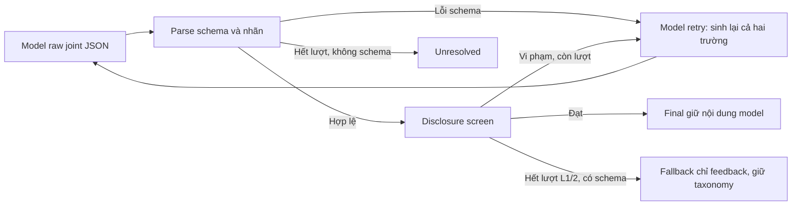

# R18 — Counterfactual Level, flow hai bước và một pilot QLoRA

**Giữ R15 làm baseline; không đóng băng candidate mới.** A xác nhận requested Level làm đổi taxonomy ngay trong first raw trên cùng code. B bảo đảm taxonomy độc lập Level ở controller nhưng vẫn sai chẩn đoán, vi phạm Level và không hoàn tất nhiều ca. C không cải thiện chất lượng đủ để chọn, đồng thời **pilot không hợp lệ theo yêu cầu cách ly lịch sử**: mình đã bỏ sót 2 ID đánh giá cũ khi khóa train. Không train lần hai để giữ giới hạn một pilot. Vì vậy lượt này **chưa cung cấp được một pilot đáp ứng đầy đủ phần C**.

Không push, không nộp leaderboard, không public inference. Cả 154 file được bảo vệ và `predictions.json` giữ nguyên bytes; SHA-256 public vẫn `9ba7411c35a3461b5747be367274631d5122455335061005c695276ed76c5a45`. Public predictions chỉ được hash, không làm target hay dùng chọn prompt/checkpoint. Điểm tổng public không dùng đánh giá phương pháp.

## A — Nguyên nhân từ đâu?

Đọc đúng `round15.py`, `round15_runner.py`, disclosure screen và config zero-shot. Parser chỉ kiểm schema/10 nhãn rồi trả nguyên labels. Guard chỉ quyết định chấp nhận hoặc retry. Sau tối đa 3 attempts, fallback Level1/2 **chỉ thay feedback**, copy taxonomy từ latest valid schema; lỗi runtime/không có schema được giữ unresolved. Không có controller gán taxonomy thành `[]`.

Khóa trước inference **20 code train-only / 10 family**, có 3 compile-error, 4 scoped-clean, lỗi logic/edge/loop/array/hard-code/I/O và finding thuật toán từ ZIP mới. Hai code/family có identity khác nhau; không đổi ID sau output. Mọi first-user payload sau khi bỏ `requested_level` bằng nhau cho cùng code; system prompt và compiler evidence cũng bằng nhau. Level1–3 cùng greedy/seed42/NF4/revision, cap1024. Bốn Level4 giữ cap1536 của R15 nên chỉ mô tả thêm, không đưa vào chỉ số invariance chính.

64/64 lượt, 78 attempts. **First raw invariance 8/20; final invariance 8/20.** 12 code đổi tập nhãn ngay khi chỉ thay Level1–3. `[]` theo Level: **17/20, 5/20, 5/20**; Level4 là0/4. Trong bộ counterfactual không có taxonomy transition qua retry và không có sửa taxonomy bởi controller. Có4 feedback fallback (L1:3, L2:1). Đây là bằng chứng phụ thuộc Level tại output model trong flow joint; chưa phải ablation chứng minh một câu cụ thể trong prompt là nguyên nhân.

Paired evaluation sau đó còn cho thấy retry có thể đổi taxonomy: COUNTGT-0023 ở cùng L1 đi `[] → LG → []` qua3 attempts. Parser/controller vẫn không đổi nhãn. Vì vậy kết luận tách biệt: **coupling first raw là hiện tượng chính ở counterfactual; retry có thể đổi thêm taxonomy trong ca khác; fallback không xóa taxonomy**.

## B — Flow mới sửa được gì?

`two_stage.py`: diagnostic input chỉ có đề, problems/prototype/prerequisite, policy, code, compiler; không requested Level, gold hoặc teacher feedback. Diagnostic trả status, taxonomy, finding có quote/location/evidence và basis. Feedback nhận cùng chẩn đoán cộng Level; final taxonomy copy từ chẩn đoán. Cache key gồm source/context/compiler/config, không Level. Quote tồn tại chỉ xác nhận liên kết source, không xác nhận suy luận đúng.

Không content retry hoặc clean fallback. Parse/status/quote sai và uncertain đều vào journal riêng; không có final prediction giả sạch. Prompt yêu cầu L1 không vị trí/nguyên nhân, L2 có vị trí/nguyên nhân nhưng không repair, L3 có hướng sửa khả thi, L4 cho phép sample solution. **Đây là yêu cầu prompt, không phải bảo đảm model tuân thủ.**

Counterfactual B:14/20 diagnosis accepted,6 lỗi; hoàn tất42/64 feedback requests. Có13/20 code đủ cảL1–3 và **13/13 triple ấy invariant**. Tất cả42 output copy đúng taxonomy diagnostic; không claim20/20 thành công. L1/L2/L3 hoàn tất14/13/14, trong đó8 `[]` ở mỗi Level; L4 hoàn tất1/4. Nhiều clean diagnosis sai vì model suy compile-pass thành đúng. L1 còn disclosure, L2 có repair leak, L3 có nguyên nhân sai hoặc gợi ý chung. Flow sửa hợp đồng truyền taxonomy, **chưa sửa được độ đúng và compliance**.

## C — Pilot, sai sót cách ly và paired evaluation

ZIP bytes đúng `6bda70c29254a3bce91933b65f4a311d73a052e72d181c97e977152e14602f9b`:627 root records,27 AL-positive; heldout65 có6 AL-positive. Annotation hash `38da5e36636ba74315b3e0d6e8e25e7240595b7cb2dcf33ef00dcc21542f9a32`. Không suy version từ tên file. Các source cũ được chọn khớp bytes archive hiện tại.

Khóa16 evaluation IDs /8 family trước model; mỗi Level4 record,12 bài có defect xác nhận và4 scoped-clean. Train dùng20 code (18 synthetic từ fixed train membership,2 real-train), mỗi code1 diagnostic + feedback L1/2/3 =80 example. Target do assistant viết từ source, compiler hoặc counterexample; **không human verified**, không train trực tiếp teacher/synthetic prose. 80 target supervised5558 token, sequence dài nhất3311, prompt được mask, không truncate. Nhãn v2 giữ nguyên, bất đồng source ghi riêng. Scoped-clean ghi rõ miền ASCII/int/nonempty/no-overflow, không coi compile pass là proof.

**Sai sót của mình:** gate trước train đã loại code/group/renamed-identity và toàn bộ family của counterfactual/evaluation hiện tại, sáu real-val và old heldout, nhưng quên danh sách development R15/R16/R17. Audit sau train tìm thấy `SYN-COUNTEVEN-0001` (R17) và `SYN-SUMPAIR-0003` (R15/R16) trong20 train code. Không trùng16 paired evaluation hiện tại và không trùng65 heldout mới, nhưng vẫn vi phạm yêu cầu bảo vệ lịch sử. Không bỏ2 ID khỏi manifest sau chạy để hợp thức hóa. Adapter bị loại khỏi candidate. Đã thêm regression test và gate trước ghi target/trước train; lệnh train hiện tại sẽ từ chối target set này. Exact script đã chạy được lưu ignored và đối chiếu hash trong manifest.

R16/R17 vốn là train development từng xem output; sáu real-val và heldout cũ đã được đánh giá nhiều lượt, R13 từng xem corpus. Các family và template liên quan từng xuất hiện trong nghiên cứu. Bộ16 hiện tại có fresh appended algorithm source nhưng **không phải benchmark mù**, không chứng minh generalization sang family hoàn toàn mới. Train family không trùng hai bộ hiện tại vẫn có chung motif/template; code/group/rename filtering không chứng minh loại mọi semantic near-duplicate.

Một optimizer run: Qwen2.5-Coder-7B-Instruct revision `c03e6d358207e414f1eca0bb1891e29f1db0e242`, NF4 double-quant/BF16 compute, RTX5090 32GB; LoRA r16/alpha32/dropout0.05, q/k/v/o/gate/up/down, lr1e-4 cosine, warmup0.03, seed42, batch1×accum4,1 epoch/20 steps. Chỉ lưu final adapter, không eval-loss checkpoint selection/sweep. Peak allocated15.86GiB, reserved24.46GiB, model-load+train/save41.0s. Gradient hữu hạn/khác0 và LoRA update khác0 được kiểm tra. Adapter hash `d3b45d96331f54c62722f697ae8b45048bc87d5d795c059f9f683233ec94af79`. Train loss1.338 **không là tiêu chí thành công**.

A/B/C cùng16 inputs, decoder/precision/revision/compiler và requested Level. C dùng đúng final adapter, không đổi frozen prompt. Legacy adapter loader gặp nhầm PEFT wrapper `Linear4bit` trước generation; loader riêng kiểm actual bitsandbytes layers/BF16, không sửa backend R15. Các lỗi setup trước optimizer không phải pilot bổ sung.

| Trên16 ID cố định | A R15 | B hai bước base | C adapter, không hợp lệ |
|---|---:|---:|---:|
|Final hoàn tất|16|12|11|
|Micro-F1 v2|0.2500|0.0000|0.1739|
|Macro-F1 v2, đủ10 nhãn|0.1000|0.0000|0.0667|
|Exact set v2 /16|3|1|2|
|Lỗi JSON attempts|0|0|2|
|Unresolved IDs|0|4|5|
|Fallback|0|0|0|
|Raw có material false claim /16|7|5|11|
|Final có material false claim /16|7|3|4|
|Final false-clean assurance /16|4|2|3|
|Final [] trên12 defect xác nhận|5|4|3|
|L1 final disclosure /4 requested|0|3|3 (chỉ3 final)|
|L2 strict hữu ích /2 defect|0|0|0|
|L2 final concrete repair leak /4 requested|0|0 (chỉ1 final)|0 (chỉ3 final)|
|L3 cause + feasible repair /4 defect|1|0|0|

B có1 L3 repair cho capacity100, ghi riêng conditional-useful; không thay thế việc sửa lỗi algorithm độc lập-extrema đã xác nhận. Source-reference micro-F1 A/B/C =0.2727/0/0.2857; mapping AL-vs-LG và gold nhiễu ảnh hưởng mạnh. C có F1 hơn B nhưng raw false claims11 so5, final hoàn tất11 so12, không tăng L2/L3 usefulness. **Không chọn C theo F1 hoặc loss.** B ít final false claims hơn A nhưng có4 unresolved; không kết luận B tốt hơn chỉ từ final còn lại.

F1 luôn đủ10 nhóm, zero_division0; error/abstention không được thưởng exact-clean và không xuất thành `[]`. Raw của B/C bao gồm diagnostic và feedback nên có nhiều cơ hội phát biểu hơn A; số record có false claim không phải atomic-claim precision. Source-refuted tách khỏi generic false-clean và giả định file/checker/domain chưa chứng minh. Review hoàn toàn assistant, nhạy với ranh giới disclosure; xem từng rationale trong ledger.

### TP/FP/FN theo nhãn v2

| Nhãn | Support | A | B | C |
|---|---:|---:|---:|---:|
|Lỗi biên dịch|3|3/0/0|0/0/3|2/1/1|
|Lỗi nhập/xuất|0|0/0/0|0/0/0|0/3/0|
|Lỗi logic|0|0/6/0|0/4/0|0/2/0|
|Lỗi vòng lặp|0|0/0/0|0/0/0|0/0/0|
|Lỗi mảng/chuỗi|0|0/0/0|0/1/0|0/0/0|
|Lỗi hàm|0|0/0/0|0/0/0|0/0/0|
|Lỗi edge case|0|0/0/0|0/0/0|0/0/0|
|Lỗi thuật toán|8|0/0/8|0/0/8|0/0/8|
|Lỗi hard-code|0|0/0/0|0/0/0|0/0/0|
|Lỗi style|4|0/0/4|0/0/4|0/0/4|

## Bảng từng code

Ký hiệu: BC biên dịch; IO nhập/xuất; LG logic; LP vòng lặp; AR mảng/chuỗi; FN hàm; EC edge case; AL thuật toán; HC hard-code; ST style. `ERR` là không có output, khác `[]`. Mọi ID dưới có tiền tố `SYN-`. Source evidence đầy đủ, finding đúng/sai và **tất cả raw/final hashes** ở [ledger JSON](TASK3_ROUND18_RESULTS_20261020.json); feedback nguyên văn và raw attempts ở ignored `outputs/task3/round18/`.

### Counterfactual20 code

| ID | A L1 | A L2 | A L3 | B diagnostic | B đủ triple | Source/feedback review ngắn |
|---|---|---|---|---|---|---|
|ARM-0007|[]|LG|LG|ERR|không|Đếm chữ số giảm; A L2 thấy lỗi, L3/4 bịa; B quote/counterexample sai.|
|ARM-0022|BC|BC|BC|ERR|không|Thiếu semicolon; A sửa comma sai; B status sai.|
|DIGITSUM-0015|[]|LG|LG|LG|không|Cộng quotient; A/B L3 sửa khả thi; B L1 lộ, L2 JSON lỗi.|
|DIGITSUM-0012|BC|BC|BC|ERR|không|Thiếu semicolon; model bịa comma/brace.|
|DISTINCT-0004|[]|LG|LG|LG|có|Singleton trả0; A bịa recursion, B thấy đúng.|
|DISTINCT-0012|[]|LG|LG|LG|có|Counter giảm; A nói luôn0 sai, B thấy đúng.|
|PRIME-0004|[]|LG|LG|[]|có|Sai2 và square; B sạch sai, feedback L2 tự thấy lỗi.|
|PRIME-0007|[]|[]|[]|[]|có|Scoped clean; B xem comment tmp2 là biến active.|
|GCDARR-0003|[]|LG|LG|LG|có|Duyệt tới n, extra input/uninitialized; capacity1000.|
|GCDARR-0007|[]|[]|[]|[]|có|Quotient thay modulus; A/B bỏ sót.|
|POWER-0003|[]|LG|LG|LG|có|Scoped clean; A bịa r=0, B gán lỗi hiệu suất thiếu time bound.|
|POWER-0006|[]|LP|LP|ERR|không|Thiếu tăng lan; A nói có tăng, B schema reject.|
|COUNTUPPER-0003|[]|[]|[]|[]|có|Scoped ASCII clean; style không có nghĩa lỗi logic.|
|COUNTUPPER-0009|[]|LG|LG|ERR|không|Bỏ A; đọc terminator hợp lệ, model bịa out-of-bounds.|
|REVSTR-0004|[]|LG|LG|[]|có|Swap lại cặp giữa khi độ dài chẵn; B sạch sai.|
|REVSTR-0010|BC|BC|BC|ERR|không|Thiếu semicolon; A bịa comma/parentheses, B status reject.|
|BASE2-0004|[]|[]|[]|[]|có|Scoped nonnegative int clean.|
|BASE2-0008|[]|LG|LG|LG|có|Hard-code5 rồi đọc lần hai; A nói __n unused sai.|
|SUMEVEN-0003|[]|IO|IO|[]|có|Extra input prompt; newline repair không bỏ prompt.|
|SUMEVEN-0004|[]|[]|[]|[]|có|Singleton even trả0; cả hai bỏ sót.|

### Evaluation16 code

| ID | Level | A | B | C | Finding xác nhận trước model |
|---|---:|---|---|---|---|
|FACT-0009|1|[]|LG|IO|Corrected before paired inference: n=5 rounded Stirling118 vs factorial120; original n=4 prose wrong. See data audit errata.|
|FACT-0003|2|[]|[]|BC|Exact product2..n initialized1, n=0/1 returns1,20! fits signed64; comments/TODO not defect.|
|PERFECT-0024|3|LG|[]|[]|Only adds divisors<=sqrt, omits partner divisors:6 gives3 instead of6, henceFalse instead ofTrue.|
|PERFECT-0005|4|[]|[]|LG|Loops1..n-1 sums all proper divisors; rejects1. At n<=1e8 sum fits int; O(n) may be slow, time limit unspecified; do not declare TLE as measured.|
|SECONDMAX-0010|1|[]|LG|ERR|[1,5,10] prints9 instead of5; maximum minus1 need not appear in input.|
|SECONDMAX-0003|2|LG|ERR|ERR|Scoped clean for2<=n<=1000 distinct ints; initializes two extrema and preserves invariant. n<2 and capacity domain unspecified, report conditional limitations.|
|FIB-0016|3|[]|[]|[]|Double Binet loses exact integer precision: n=71 approximately308061521170130 vs exact308061521170129 (signed64 fits). Platform rounding counterexample must be checked.|
|FIB-0015|4|BC|ERR|ERR|Missing semicolon after pair of previous-term declarations.|
|COUNTGT-0023|1|[]|LG|LG|Rows(3,1),(0,1): totals3>2 returns2; only first row satisfiesa>b, expected1. Fixed capacity100 also conditional input limit.|
|COUNTGT-0022|2|BC|ERR|BC|Missing semicolon after dynamic allocation; no main is permitted by function prototype task.|
|MAXDIFF-0013|3|LG|[]|[]|Rows(10,9),(2,1) have max difference1; independently chosen maxA-minB gives9. Capacity100 and empty file are conditional limitations.|
|MAXDIFF-0000|4|LG|[]|ERR|Scoped clean nonempty file with differences/sum fitting int: counts rows then exact allocation, sums differences, max of row differences, printsP2. Empty-file policy unspecified; conditional issue not invented compile error.|
|MINA-0019|1|[]|[]|IO|One left-to-right bubble pass on a=[3,2,1] leaves[2,1,3], returns2 instead of1. Capacity100 conditional.|
|MINA-0017|2|BC|ERR|BC|Missing semicolon after vector declaration.|
|PROD-0026|3|LG|AR|ERR|Rows(10,1),(1,10): both products10, independent maxima product100 not present. Capacity100/empty domain conditional.|
|PROD-0013|4|LG|LG|IO|P2 returns0 regardless of records; P4 empty. One row(2,3) requires sum6 and printed6. v2 style-only contradicted by source.|

## Artifacts và tái tính

- [Freeze selection/source expectations](TASK3_ROUND18_FREEZE_20261020.json), [data/version audit và errata](TASK3_ROUND18_DATA_AUDIT_20261020.json). Initial expected prose FACT0009 n=4 bị sai số học, đã kiểm trước paired inference và ghi errata n=5; không đổi ID/label/source hay xóa original freeze.
- [80 target provenance](TASK3_ROUND18_TARGET_PROVENANCE_20261020.json), [pilot eligibility lỗi lịch sử](TASK3_ROUND18_PILOT_ELIGIBILITY_20261020.json), [run/config/checkpoint/VRAM/commands](TASK3_ROUND18_RUN_MANIFEST_20261020.json).
- Source/raw/feedback/targets/checkpoint nằm ignored: `data/raw/round18-new/`, `outputs/task3/round18/`, `checkpoints/task3/r18-pilot/adapter/`. Không có public prompt hoặc student source đầy đủ được commit.
- Offline tái tính: `.venv-task3/bin/python scripts/task3_round18_report.py`. Các lệnh model đã chạy nằm trong manifest; không chạy lại lượt inference để điều chỉnh nội dung. Gate single-pass chặn ghi đè artifacts. `task3_round18_train.py` hiện từ chối target set lịch sử này; không hướng dẫn bypass như một pilot hợp lệ.
- Verification: **659 passed,4 skipped**, gồm28 test mới. [Verification JSON](TASK3_ROUND18_VERIFICATION_20261020.json) ghi protected hash checks và review độc lập: tái tính metric/154 hashes đúng, không có lỗi quan trọng mới ngoài pilot đã bị loại.

Kết luận riêng: **A xác nhận model-output coupling theo Level; B tách taxonomy đúng ở interface nhưng chưa đủ chất lượng; C thất bại cả điều kiện cách ly lịch sử và tiêu chí feedback để chọn candidate.** Không có một pilot C hợp lệ để tuyên bố hoàn thành mục tiêu fine-tune trong lượt này.
